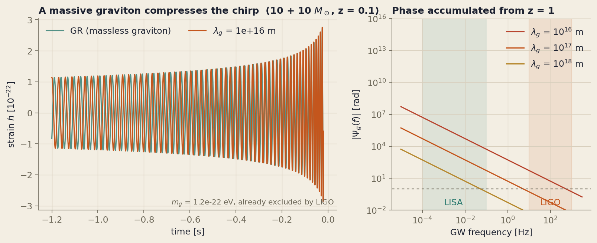
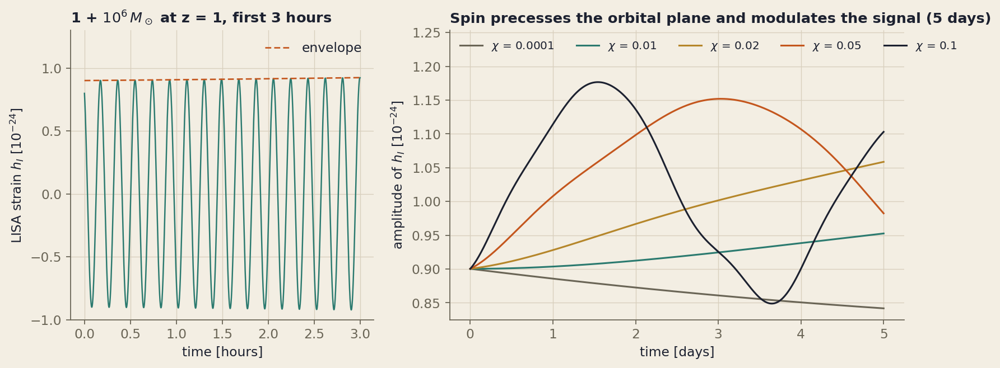

# GWave

Gravitational-wave signals from inspiralling compact binaries and extreme-mass-ratio inspirals,
for ground-based (LIGO) and space-based (LISA) detectors, and how a massive graviton would
distort them.


`gwave` builds the time-domain strain an interferometer sees from a binary of two point masses
during its inspiral. The orbital phase is evolved to Newtonian (0PN) or second post-Newtonian (2PN)
order, the amplitude is kept at leading (quadrupole) order, and the signal is projected onto
an L-shaped detector or onto LISA. Sources can sit at cosmological distances, and the signal
can be propagated with a massive graviton. It is the code behind my
[M.Sc. dissertation](https://imperialcollegelondon.app.box.com/s/gs08vpfud1nobnqrsbrmj6vsoplzv84c),
*Modelling Gravitational Waves in a Massive Gravity Theory* (Imperial College London, 2019),
rewritten to be read as much as run.

## Physics

For component masses $m_1, m_2$ (total mass $M$, symmetric mass ratio $\nu = m_1 m_2/M^2$, chirp
mass $\mathcal{M} = \nu^{3/5} M$), the natural clock is the dimensionless time to coalescence

$$\Theta = \frac{\nu c^3}{5 G M}\,(t_c - t).$$

The GW frequency and phase are power series in $\Theta^{-1/8}$
([Blanchet 2014](https://doi.org/10.12942/lrr-2014-2)):

$$f = \frac{c^3}{8\pi G M}\Big[\Theta^{-3/8} + \Big(\tfrac{743}{2688} + \tfrac{11}{32}\nu\Big)\Theta^{-5/8} - \tfrac{3\pi}{10}\Theta^{-3/4} + \Big(\tfrac{1855099}{14450688} + \tfrac{56975}{258048}\nu + \tfrac{371}{2048}\nu^2\Big)\Theta^{-7/8}\Big],$$

$$\Phi = \Phi_c - \frac{2}{\nu}\Big[\Theta^{5/8} + \Big(\tfrac{3715}{8064} + \tfrac{55}{96}\nu\Big)\Theta^{3/8} - \tfrac{3\pi}{4}\Theta^{1/4} + \Big(\tfrac{9275495}{14450688} + \tfrac{284875}{258048}\nu + \tfrac{1855}{2048}\nu^2\Big)\Theta^{1/8}\Big].$$

Keeping only the first term in each bracket gives the Newtonian chirp. The polarizations for a
source at distance $r$ and inclination $\iota$ are

$$h_+ = \frac{4}{r}\Big(\frac{G\mathcal{M}}{c^2}\Big)^{5/3}\Big(\frac{\pi f}{c}\Big)^{2/3}\frac{1+\cos^2\iota}{2}\cos\Phi, \qquad
h_\times = \frac{4}{r}\Big(\frac{G\mathcal{M}}{c^2}\Big)^{5/3}\Big(\frac{\pi f}{c}\Big)^{2/3}\cos\iota\,\sin\Phi,$$

and the detector measures $h = F_+ h_+ + F_\times h_\times$, with

$$F_+ = \tfrac12(1+\cos^2\theta)\cos 2\phi\cos 2\psi - \cos\theta\sin 2\phi\sin 2\psi, \qquad
F_\times = \tfrac12(1+\cos^2\theta)\cos 2\phi\sin 2\psi + \cos\theta\sin 2\phi\cos 2\psi .$$

The series is cut off at the Schwarzschild ISCO, $f_{\rm ISCO} = c^3/(6^{3/2}\pi G M)$, where the
inspiral description stops being trustworthy. Merger and ringdown are not modelled.

For a source at redshift $z$ every mass scale is redshifted, $\mathcal{M} \to (1+z)\mathcal{M}$,
and $r$ becomes the luminosity distance $d_L(z)$ of a flat ΛCDM universe (Planck 2015 parameters).

## Why the post-Newtonian terms matter

A detector has to track the phase of a signal to within a fraction of a cycle over thousands of
cycles. The Newtonian phase drifts by hundreds of cycles for a binary neutron star:


The 2PN cycle counts from 10 Hz to the ISCO (16,275 for 1.4+1.4 $M_\odot$, 3,619 for 1.4+10,
614 for 10+10) agree with the literature values to better than 0.1%; this is one of the tests.

## Where a detector is deaf


The total response $\sqrt{F_+^2 + F_\times^2}$ does not depend on the polarization angle
$\psi$. It is largest overhead and vanishes in the detector plane along the bisectors of the arms.

## A massive graviton

If the graviton has a mass $m_g$, with Compton wavelength $\lambda_g = h/(m_g c)$, its dispersion
relation $E^2 = p^2c^2 + m_g^2c^4$ makes low frequencies travel slightly more slowly. Over a
cosmological distance each frequency picks up a phase
([Will 1998](https://doi.org/10.1103/PhysRevD.57.2061))

$$\Psi_g(f) = -\frac{\pi c\, D(z)}{(1+z)\,\lambda_g^2 f}, \qquad
D(z) = \frac{(1+z)\,c}{H_0}\int_0^z \frac{dz'}{(1+z')^2 E(z')},$$

so the frequency $f$ arrives late by $\Delta t(f) = \frac{1}{2\pi}\frac{d\Psi_g}{df} \propto f^{-2}$.
The early, low-frequency part of a chirp is delayed most, and the signal is compressed:



Because $\Psi_g \propto 1/f$, the effect is largest at low frequencies and large distances, which
is why LISA sources would bound $m_g$ far more tightly than LIGO ones.

`gwave.massive_gravity.propagate` applies this in the time domain. Each sample is moved to its
arrival time, its phase is shifted by $-2\Psi_g(f)$ (the phase and group velocities differ),
and its amplitude is rescaled by the local compression. This avoids the wrap-around and edge
artefacts of doing it with an FFT of a finite signal, the problem the dissertation worked
around with windowing. A test checks it against a carefully zero-padded FFT calculation: the two
agree to better than 1%, while the massive and massless signals differ by order 100%.

## LISA

`gwave.lisa` gives the two effective detectors formed by LISA's three arms,
$h_{I,II} = \frac{\sqrt3}{2}(F^{I,II}_+ h_+ + F^{I,II}_\times h_\times)$, where detector II is
detector I rotated by 45°. It also includes the Doppler phase from LISA's orbit around the Sun,
$\Phi_D = 2\pi f\,(R/c)\sin\theta_s\cos(2\pi t/\mathrm{yr} - \phi_s)$. The constellation's slow
rotation is not modelled, so signals should be short compared with a year.

## Extreme-mass-ratio inspirals

`gwave.emri` follows a compact object of mass $\mu$ around a spinning black hole of mass
$M \gg \mu$, in the analytic-kludge model of
[Barack & Cutler (2004)](https://doi.org/10.1103/PhysRevD.69.082005) restricted to circular
orbits. With $x = (2\pi M\nu)^{2/3}$, spin $\chi = S/M^2$ and $\lambda$ the angle between the orbital
angular momentum and the spin ($G = c = 1$):

$$\dot\nu = \frac{96}{10\pi}\frac{\mu}{M^3}(2\pi M\nu)^{11/3}\Big[1 + \tfrac{1273}{336}x - \tfrac{73}{12}(2\pi M\nu)\,\chi\cos\lambda\Big],$$

$$\dot{\tilde\gamma} = 6\pi\nu\,x\,(1 + \tfrac{13}{2}x) - 24\pi^2\nu^2 M\chi\cos\lambda, \qquad
\dot\alpha = 8\pi^2\nu^2 M\chi .$$

The last term is Lense–Thirring precession: the black hole's spin drags the orbital plane around
it. The wave is the quadrupole field of the orbit, built from vectors and projected onto LISA's arms
as they orbit and cartwheel through the year. The precessing plane modulates the signal, more
strongly the faster the black hole spins:



## Usage

```python
import gwave
from gwave import Binary

b = Binary(1.46, 1.27)                     # GW170817-like, solar masses
print(b.chirp_mass, b.f_isco)              # 1.185 M_sun, ~1.6 kHz

t, h = gwave.inspiral(b, distance_mpc=40, iota=0.4, f_low=30, sample_rate=4096)
f = gwave.gw_frequency(b, t)               # GW frequency along the signal

import numpy as np

# a GW150914-like source at z = 0.09, with and without a massive graviton
from gwave import massive_gravity as mg
t, h_gr, h_mg = mg.massive_inspiral(Binary(36, 29), z=0.09, lambda_g=1e16, f_low=20)

# an EMRI seen by LISA (dissertation's "EMRI Event 1")
from gwave import emri
system = emri.EMRI(mu=1, M=1e6, chi=0.1, lam=np.pi / 6)
t, hI, hII = emri.lisa_emri(system, np.arange(0, 5 * 86400, 10.0), nu0=5e-4,
                            distance_mpc=gwave.cosmology.luminosity_distance(1.0),
                            theta_s=np.pi / 4, phi_s=np.pi / 4, theta_k=np.pi / 3, phi_k=np.pi / 4, z=1.0)

# LISA, ten years before merger
from gwave import lisa
b = Binary(10, 100).redshifted(2)
t = -10 * gwave.YEAR + np.arange(0, 86400, 5.0)
h_I, h_II = lisa.lisa_strain(b, t, gwave.cosmology.luminosity_distance(2), iota=1.0, theta=0.8)
```

All masses are in solar masses, distances in Mpc, times in seconds and frequencies in Hz.

```
gwave/inspiral.py         Binary, PN frequency and phase, polarizations, antenna pattern, strain
gwave/cosmology.py        luminosity distance d_L(z) and the graviton distance D(z)
gwave/lisa.py             LISA's two detectors, its orbiting frame, the orbital Doppler phase
gwave/emri.py             extreme-mass-ratio inspirals (analytic kludge, circular orbits)
gwave/massive_gravity.py  massive-graviton phase, group delay, and time-domain propagation
examples/make_figures.py  regenerates every figure in this README
tests/                    physics checks (see below)
```

## Running

```bash
pip install -r requirements.txt
python examples/make_figures.py      # writes figures/*.png
python -m pytest                     # runs the tests
```

The tests check physics, not just that the code runs:

- **Consistency of the PN coefficients.** $2\pi f(t) = d\Phi/dt$ at 0PN and 2PN.
- **Literature cycle counts.** Cycles from 10 Hz to the ISCO match the published values for
  BNS, NSBH and BBH systems.
- **Antenna pattern invariance.** $F_+^2 + F_\times^2$ is independent of $\psi$.
- **Reference values.** Standard chirp masses, ISCO frequencies and strain amplitudes.
- **Cosmology.** $d_L$ and $D$ reproduce their closed forms in a matter-only universe and
  Hubble's law at low redshift.
- **Massive graviton.** The group delay is the derivative of the phase, the massless limit
  returns GR, and the time-domain propagation matches an independent FFT calculation.
- **EMRIs and LISA.** LISA's orbiting frame reproduces Cutler's closed-form angles to machine
  precision. The EMRI frequency evolution reduces to the quadrupole chirp, and the precession
  rates match the dissertation's equations. The vector-built wave equals the textbook
  $F_+h_+ + F_\times h_\times$, and spin modulates the amplitude only when it should.

## History

I wrote the original code in 2019 for my M.Sc. dissertation at Imperial: five scripts covering
LIGO and LISA signals, an analytic-kludge model of extreme-mass-ratio inspirals, and
massive-graviton propagation. The final versions were lost in a computer crash. An early draft
survives in this repository's history under the tag `msc-2019`, and the final programs are
printed in the dissertation's appendix.

In 2026 I rebuilt the package from those programs and the dissertation's equations with help from an AI coding assistant
(Claude). The rebuild:

- fixed a total-mass bug (operator precedence) and a term and sign error in the LIGO antenna
  pattern;
- fixed an exponent in the EMRI periapsis-advance rate (the code had $x^{8/3}$ where
  eq. 4.46 has $x^{2/3}$);
- replaced the FFT-based massive-graviton step with a time-domain method that needs no
  windowing;
- rebuilt the EMRI and LISA geometry from vectors, because the printed code is truncated at the
  page margin;
- added the tests and figures.

The physics, the choice of formulas and the structure of the calculation follow the
dissertation.

## License

MIT. See [LICENSE](LICENSE).

## References

- L. Blanchet, *Gravitational Radiation from Post-Newtonian Sources and Inspiralling Compact
  Binaries*, [Living Rev. Relativ. 17, 2 (2014)](https://doi.org/10.12942/lrr-2014-2).
- B. S. Sathyaprakash and B. F. Schutz, *Physics, Astrophysics and Cosmology with Gravitational
  Waves*, [Living Rev. Relativ. 12, 2 (2009)](https://doi.org/10.12942/lrr-2009-2).
- M. Maggiore, *Gravitational Waves, Vol. 1: Theory and Experiments*, Oxford University Press (2008).
- C. M. Will, *Bounding the mass of the graviton using gravitational wave observations of
  inspiralling compact binaries*, [Phys. Rev. D 57, 2061 (1998)](https://doi.org/10.1103/PhysRevD.57.2061).
- C. Cutler, *Angular resolution of the LISA gravitational wave detector*,
  [Phys. Rev. D 57, 7089 (1998)](https://doi.org/10.1103/PhysRevD.57.7089).
- L. Barack and C. Cutler, *LISA capture sources: Approximate waveforms, signal-to-noise
  ratios, and parameter estimation accuracy*, [Phys. Rev. D 69, 082005 (2004)](https://doi.org/10.1103/PhysRevD.69.082005).
