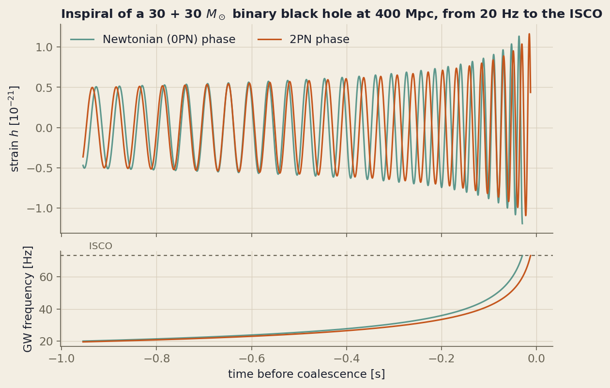
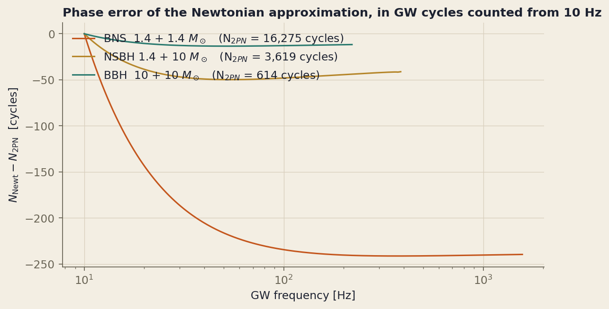
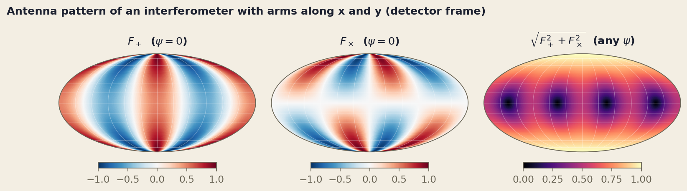

# GWave

Post-Newtonian gravitational-wave signals from inspiralling compact binaries, in a single small
Python module.



`gwave` builds the time-domain strain an interferometer sees from a binary of two point masses
during its inspiral. The orbital phase is evolved to Newtonian (0PN) or second post-Newtonian (2PN)
order, the amplitude is kept at leading (quadrupole) order, and the signal is projected onto
an L-shaped detector through its antenna pattern. It started as part of my
[M.Sc. dissertation](https://imperialcollegelondon.app.box.com/s/gs08vpfud1nobnqrsbrmj6vsoplzv84c)
at Imperial College London on gravitational waves in massive gravity, and it is written to be
read as much as run.

## Physics

For component masses $m_1, m_2$ (total mass $M$, symmetric mass ratio $\nu = m_1 m_2/M^2$, chirp
mass $\mathcal{M} = \nu^{3/5} M$), the natural clock is the dimensionless time to coalescence

$$\Theta = \frac{\nu c^3}{5 G M}\,(t_c - t).$$

The GW frequency and phase are power series in $\Theta^{-1/8}$
([Blanchet 2014](https://doi.org/10.12942/lrr-2014-2)):

$$f = \frac{c^3}{8\pi G M}\Big[\Theta^{-3/8} + \Big(\tfrac{743}{2688} + \tfrac{11}{32}\nu\Big)\Theta^{-5/8} - \tfrac{3\pi}{10}\Theta^{-3/4} + \Big(\tfrac{1855099}{14450688} + \tfrac{56975}{258048}\nu + \tfrac{371}{2048}\nu^2\Big)\Theta^{-7/8}\Big],$$

$$\Phi = \Phi_c - \frac{2}{\nu}\Big[\Theta^{5/8} + \Big(\tfrac{3715}{8064} + \tfrac{55}{96}\nu\Big)\Theta^{3/8} - \tfrac{3\pi}{4}\Theta^{1/4} + \Big(\tfrac{9275495}{14450688} + \tfrac{284875}{258048}\nu + \tfrac{1855}{2048}\nu^2\Big)\Theta^{1/8}\Big].$$

Keeping only the first term in each bracket gives the Newtonian chirp. The polarizations for a
source at distance $r$ and inclination $\iota$ are

$$h_+ = \frac{4}{r}\Big(\frac{G\mathcal{M}}{c^2}\Big)^{5/3}\Big(\frac{\pi f}{c}\Big)^{2/3}\frac{1+\cos^2\iota}{2}\cos\Phi, \qquad
h_\times = \frac{4}{r}\Big(\frac{G\mathcal{M}}{c^2}\Big)^{5/3}\Big(\frac{\pi f}{c}\Big)^{2/3}\cos\iota\,\sin\Phi,$$

and the detector measures $h = F_+ h_+ + F_\times h_\times$, with

$$F_+ = \tfrac12(1+\cos^2\theta)\cos 2\phi\cos 2\psi - \cos\theta\sin 2\phi\sin 2\psi, \qquad
F_\times = \tfrac12(1+\cos^2\theta)\cos 2\phi\sin 2\psi + \cos\theta\sin 2\phi\cos 2\psi .$$

The series is cut off at the Schwarzschild ISCO, $f_{\rm ISCO} = c^3/(6^{3/2}\pi G M)$, where the
inspiral description stops being trustworthy. Merger and ringdown are not modelled, and
cosmological redshift is ignored, so the distance is the luminosity distance of a nearby
($z \ll 1$) source.

## Why the post-Newtonian terms matter

A detector has to track the phase of a signal to within a fraction of a cycle over thousands of
cycles. The Newtonian phase drifts by hundreds of cycles for a binary neutron star:



The 2PN cycle counts from 10 Hz to the ISCO (16,275 for 1.4+1.4 $M_\odot$, 3,619 for 1.4+10,
614 for 10+10) agree with the literature values to better than 0.1%; this is one of the tests.

## Where a detector is deaf



The total response $\sqrt{F_+^2 + F_\times^2}$ does not depend on the polarization angle
$\psi$. It is largest overhead and vanishes in the detector plane along the bisectors of the arms.

## Usage

```python
import gwave
from gwave import Binary

b = Binary(1.46, 1.27)                     # GW170817-like, solar masses
print(b.chirp_mass, b.f_isco)              # 1.185 M_sun, ~1.6 kHz

t, h = gwave.inspiral(b, distance_mpc=40, iota=0.4, f_low=30, sample_rate=4096)
f = gwave.gw_frequency(b, t)               # GW frequency along the signal
```

All masses are in solar masses, distances in Mpc, times in seconds and frequencies in Hz.

```
gwave.py                  the whole model: Binary, frequency, phase, polarizations, antenna pattern
examples/make_figures.py  regenerates every figure in this README
tests/test_gwave.py       physics checks (see below)
```

## Running

```bash
pip install -r requirements.txt
python examples/make_figures.py      # writes figures/*.png
python -m pytest                     # runs the tests
```

The tests check physics, not just that the code runs:

- **Consistency of the PN coefficients.** $2\pi f(t) = d\Phi/dt$ at 0PN and 2PN.
- **Literature cycle counts.** Cycles from 10 Hz to the ISCO match the published values for
  BNS, NSBH and BBH systems.
- **Antenna pattern invariance.** $F_+^2 + F_\times^2$ is independent of $\psi$.
- **Reference values.** Standard chirp masses, ISCO frequencies and strain amplitudes.

## History

I wrote the first version in 2019, during my M.Sc. at Imperial, as a single script. It is
preserved in this repository's history under the tag `msc-2019`. In 2026 I restructured it
into the tested module above with help from an AI coding assistant (Claude). That pass
fixed a total-mass bug and a sign error in the antenna pattern, connected the 2PN phase,
and added the tests and figures. The physics and the choice of formulas are from the
original.

## License

MIT. See [LICENSE](LICENSE).

## References

- L. Blanchet, *Gravitational Radiation from Post-Newtonian Sources and Inspiralling Compact
  Binaries*, [Living Rev. Relativ. 17, 2 (2014)](https://doi.org/10.12942/lrr-2014-2).
- B. S. Sathyaprakash and B. F. Schutz, *Physics, Astrophysics and Cosmology with Gravitational
  Waves*, [Living Rev. Relativ. 12, 2 (2009)](https://doi.org/10.12942/lrr-2009-2).
- M. Maggiore, *Gravitational Waves, Vol. 1: Theory and Experiments*, Oxford University Press (2008).
